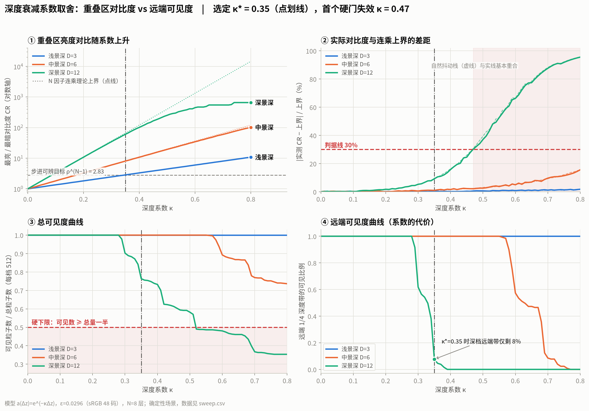

# depth

重叠粒子的按深度亮度衰减与层次对比度验证。`make test` 跑自检：深度因子公式、
视觉阈值反解、N 因子连乘恒等式、三档景深各一次运行、两条硬判据和反面控制。

解决的问题：粒子在屏幕同一像素上重叠时亮度互不相关，前后层看起来互相穿透。
给每个粒子一个深度 `z`，把它的线性光亮度乘上一个只依赖**深度差**的因子，
靠后的粒子更暗，重叠处就有了前后次序。

## 1. 深度因子关于深度差的表达式

取参考面（相机/最前层）深度 `z_ref`，深度差 `Δz = z − z_ref ≥ 0`。用指数
（Beer–Lambert 式）因子：

```
a(Δz; κ) = exp(−κ·Δz),   κ ≥ 0
L        = B·w·a(Δz; κ)          # B 本征亮度，w 精灵覆盖权重
```

选指数而不是线性衰减有两个直接理由：

- 深度可加时因子可复合：`a(d1+d2) = a(d1)·a(d2)`，这正是后面 N 层连乘界
  能写成干净乘积的原因；
- `κ = 0` 自然退化为完全不衰减，`κ` 的量纲是“每深度单位的 e 指数”。

## 2. 衰减到视觉不可分辨的深度差，与系数反解

用两档感知阈值，分别管“单个粒子看不见”和“两层分不开”。

### 2a. 绝对可见地板 ε → 远端消失深度

小而瞬态的火花在有眩光的背景上，保守的实用可见码阈值取 sRGB `c_vis = 48/255`。
反线性化得到线性光地板：

```
ε = decode_sRGB(48/255)
  = ((48/255 + 0.055)/1.055)^2.4
  = 0.02956
```

当因子把粒子压到地板上时视觉不可分辨：

```
a(d_vis) = ε  ⇒  exp(−κ·d_vis) = ε
           ⇒  d_vis(κ) = ln(1/ε) / κ
```

反过来，指定“在多深的位置刚好不可分辨”即可反解系数：

```
κ_cal = ln(1/ε) / d_vis
```

设计指定深档远端平面 `d_vis = D_deep = 12` 为临界消失点：

```
κ_cal = ln(1/0.02956) / 12 = 3.5208 / 12 = 0.2935
```

（若只关心 8-bit 可表示性，1 个码的线性地板约 `3.0e-4`，比感知地板低两个
数量级；本模块的**可见数**按更严格的 48 码统计，对比度测量则保留到低码值。）

### 2b. 层间 JND 比例 ρ → 最小可分辨深度步

理想大视场 Weber 分数约 2%，但小而瞬态的运动精灵需要实用超阈值步长，取相邻
层亮度比 `ρ = 1.16` 才算“看得出是两层”。两层深度差为 `h` 时：

```
a(h) ≤ 1/ρ  ⇒  κ ≥ ln ρ / h
等价地  Δz_JND = ln ρ / κ     （能产生一个可分辨亮度步的最小深度差）
```

最浅档 8 层跨 `D=3`，层距 `h = 3/7 = 0.4286`，这是三档里最小的层距：

```
κ_step_min = ln 1.16 / 0.4286 = 0.3463
```

它给出“层次做得出来”的系数下沿；在选定的 `κ* = 0.35` 下
`Δz_JND = 0.4241 < h_shallow`，最浅档每一步都可分辨（实测步比 1.1618）。

## 3. N 层连乘理论上界，以及为什么加大 κ 也突破不了

有序的 N 个重叠层 `z_1 ≤ z_2 ≤ … ≤ z_N`。定义每层相对前一层的深度差
`d_1 = 0`，`d_j = z_j − z_{j−1}`（`j ≥ 2`）。本征亮度与覆盖权重相同时：

```
L_N / L_1 = exp(−κ(z_N − z_1))
          = ∏_{j=1..N} exp(−κ·d_j)
          = ∏_{j=1..N} a(d_j)
```

这就是题目说的 **N 个衰减因子的连乘** `A_N`：从最亮层走到最暗层，亮度最多
（理想模型下恰为）被连乘衰减到的保留比例。常用的亮/暗对比度是它的倒数：

```
A_N = ∏_j a(d_j) ≤ 1
CR_max(κ) = L_1/L_N = 1/A_N = exp(κ(z_N − z_1))
```

程序里另有带本征亮度/覆盖差异的自然栈，其上界把已知的
`(B_1w_1)/(B_Nw_N)` 系数也乘进去（`natural_bound`），纯深度部分仍是同一个
连乘。

**为什么加大系数也突破不了这个上界：**

1. **固定 κ 时不可超越。** 每层乘什么由 `κ·d_j` 唯一决定，连乘望远镜消去成
   `exp(−κΣd_j)`。任何排序/混合技巧都不能让深度对比度超过这一层一层的乘积；
   显示链（黑位地板 `L_floor = 0.0015`、8-bit sRGB 量化）只会把几何平均后的
   比值压小，24 个标定栈上量化舍入与地板合计偏差最大 9.2%（深档）。
2. **可观测对比度有显示/感知天花板，κ 再大也穿不过去。** 测量值下限是
   `L_floor + decode_sRGB(0) = 0.0015`，故浮点黑位模型下
   `CR_obs ≲ 1.0015/0.0015 ≈ 668`；按保守感知地板算，暗于 `ε` 的层与黑
   背景不可分辨，感知对比度封顶在 `1/ε ≈ 34`，再压暗也变不出更多层次，
   有效层数反而减少。于是 κ 增大时解析上界 `exp(κD)` 继续指数上涨，实测
   CR 却在 ~600 处平台化——图①里深档实线走平、点线上界继续冲到 `10^4`
   看得很清楚。差距随之爆炸而不是被“突破”：`κ=0.47` 首个景深档差距越过
   30%；`κ=0.80` 深档差距 95.5%、可见率 35.4%，被硬判据拒绝。

## 4. 用重叠对比度与远端可见度两条曲线定系数

确定性场景，每档 512 个粒子：24 个理想 8 层标定栈（等亮度、像素中心）、
20 个带 ±8% 亮度与亚像素覆盖抖动的自然 8 层栈、160 个深度云粒子。三档景深
跨度 `D = 3 / 6 / 12`（浅/中/深）。κ 在 `[0, 0.80]` 以 0.01 网格扫 81 点，
同一场景对所有 κ 复用（公共随机数，曲线平滑）。



- ① 重叠区对比度 `CR(κ)` 单调上升，点线是连乘理论上界；
- ② 实测与上界的差距：κ ≤ 0.35 时三档都 <10%，深档随后爬升，
  **κ ≈ 0.47 首次越过 30% 判据线**，红色区段为硬门失效区；
- ③ 总可见度：深档随 κ 下滑，在 κ ≈ 0.52 处穿过 1/2 硬下限；
- ④ 远端 1/4 深度带可见度：深档在 0.28–0.36 之间断崖。

可见度上沿也可解析预估：深度在 `[0,D]` 均匀分布、单位亮度时
`V ≈ min(1, ln(1/ε)/(κD))`，`V ≥ 1/2` 给出
`κ ≤ 2ln(1/ε)/D_deep = 0.587`（计入亮度下探与码值取整后实测在 0.51→0.52
之间穿半）。
差距门的上沿 0.47 比可见度门更紧。

选系数规则：**取最小的、同时满足“最浅档每一步对比度 ≥ ρ”和三档硬门的网格
κ**——层次刚好每步可辨时，在可行窗内最省远端可见度。结果：

```
κ* = 0.35        可行窗 ≈ [0.35, 0.46]，κ=0.47 起硬门失效
κ_cal = 0.2935   （2a 的远端临界消失反解，从下方夹住）
κ_step_min = 0.3463 → 0.35（2b 的步进要求，直接定点）
```

此时深档远端带可见度只剩 7.6%，“系数大则远处消失”的代价真实存在；但总可见
数 391/512 = 76.4%，仍远高于一半。暗色版图：`depth_curves_dark.png`。

## 5. 三档景深各跑一次的结果

`./depth json`（副本在仓库 `artifacts/depth_report.json`，单档结果在
`artifacts/depth_runs/{shallow,standard,deep}.json`）：

| 档位 | D | 连乘上界 CR | 实测 CR | 差距 | 自然栈差距 | 可见数 | 可见率 | 远端带可见率 |
|---|---:|---:|---:|---:|---:|---:|---:|---:|
| shallow 浅 | 3  | 2.856  | 2.844  | **0.41%** | 0.51% | 512/512 | 100.0% | 100% |
| standard 中 | 6  | 8.145  | 8.065  | **0.98%** | 1.14% | 512/512 | 100.0% | 100% |
| deep 深    | 12 | 66.504 | 60.358 | **9.24%** | 9.20% | 391/512 | **76.4%** | 7.6% |

判据核对：

- 三档实际对比度与理论上界的差距分别 0.41% / 0.98% / 9.24%，**全部 ≤ 30%**
  （最差一档还有约 3.2 倍裕量）→ `three_dof_gap_met=1`；
- 三档可见率 100% / 100% / 76.4%，**全部 ≥ 50%** → `visible_half_met=1`；
- 带亮度/覆盖抖动的自然栈差距同样 ≤ 9.2% → `natural_gap_met=1`。

深档差距最大，是因为后端亮度已低到受黑位地板和 8-bit 量化影响；κ\* 刻意选在
取舍边缘：最深层的线性因子 `e^(−0.35·12)=0.015` 低于保守感知地板 ε（所以严格
可见数已经把它计为不可见、远端带只剩 8%），但仍高于 1 码显示地板，其码值
（约 32/255）还能被对比度测量链如实读出——这正是 9.2% 差距与 76% 总可见率
同时成立的原因。

## 6. 反面控制（证明判据真的能抓住没做出来的层次）

- **不衰减控制**：用 κ=0 的平亮度渲染，却按 κ\* 的连乘上界评分，三档差距
  65.0% / 87.8% / 98.5%，全部 >30% → `flat_control_detected=1`。注意若拿
  κ=0 自己的上界（=1）比，差距约为 0，所以另有绝对层次门
  `CR_shallow ≥ ρ^(N−1)=2.83`（实测 2.844），专门防止“根本没衰减却和平坦
  上界吻合”的漏网情况。
- **过猛控制**：κ=0.80 时深档差距 95.5%、可见率 35.4%，三档总门拒绝
  （`overdrive_rejected=1`、`overdrive_deep_crushes=1`）；浅档跨度小仍合格，
  所以判据是“三档总门”而不是要求每档都坏。

## 用法

```
make test     # 构建并跑全部自检，全过退出码 0
make csv      # 输出全 sweep 到 sweep.csv（81 κ × 3 档，表视图数据）
make plot     # 生成 depth_curves_{light,dark}.png（需要 matplotlib）
make json     # 生成 depth_report.json
make report   # 额外把 depth_report.json / depth_sweep.csv 放到 ../artifacts/
make runs     # 三档各以独立进程跑一次，JSON 写到 ../artifacts/depth_runs/
make clean
```

实现全部在 `src/depth.c`（C11，仅依赖 libm），绘图脚本在
`tools/plot_curves.py`。
