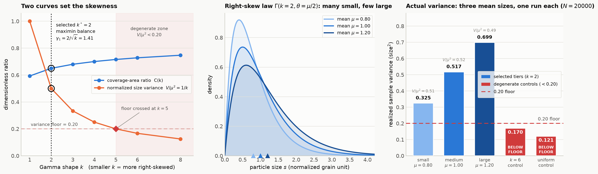

# 粒子尺寸的偏斜分布与偏斜度选择

原来的 `em_spawn` 不给尺寸，所有粒子视同一样大。这里给粒子加入 `size`，并让
新粒子的尺寸来自一个**右偏（大颗粒少、小颗粒多）**的随机分布，而不是随手取一个
均匀分布。下文先给分布形式，再推均值反解参数，然后用**覆盖面积占比**和**尺寸方差**
两条曲线定偏斜度，最后三档平均尺寸各跑一次并按 `方差 < 0.20` 判定是否退化成均匀。

实现见 `src/emitter.c`（`make test` 可复现，固定随机种子，输出确定），
曲线图：[`size_tradeoff.png`](size_tradeoff.png) / [`size_tradeoff.svg`](size_tradeoff.svg)。



---

## 1. 分布形式：Gamma

取颗粒尺寸 \(S>0\) 服从 Gamma 分布，形状参数 \(k>0\)（即偏斜旋钮）、尺度参数 \(\theta\)：

\[
S\sim\Gamma(k,\theta),\qquad
p(s)=\frac{s^{k-1}e^{-s/\theta}}{\Gamma(k)\theta^k}.
\]

选它的原因：

- \(s=0\) 附近密度最高、右尾长，天然“小颗粒多、大颗粒少”；
- \(k=1\) 退化为指数分布（最偏），\(k\to\infty\) 趋近对称、集中到单一尺寸；
- 均值/方差/偏斜都有闭式关系，便于按目标平均尺寸反解参数。

其矩为

\[
\mathbb E[S]=k\theta,\qquad
\operatorname{Var}(S)=k\theta^2,\qquad
\gamma_1=\frac{2}{\sqrt{k}}\ \text{（标准化偏斜）}.
\]

\(k\) 越小越偏斜。

## 2. 均值关系与参数反解

设目标平均尺寸为 \(\mu\)，令 \(k\theta=\mu\)，反解尺度参数：

\[
\boxed{\theta^*(\mu,k)=\frac{\mu}{k}}.
\]

代回方差：

\[
\operatorname{Var}(S)=k\left(\frac{\mu}{k}\right)^2=\frac{\mu^2}{k},
\qquad
\frac{\operatorname{Var}(S)}{\mu^2}=\frac1k .
\]

所以同一个 \(k\) 给出同一个**无量纲（归一化）方差** \(1/k\)，与平均尺寸档位无关；
绝对方差则随 \(\mu^2\) 缩放。C 里 `theta = target / k` 即此反解，
`mean_inversion`、`inverse_scale_medium` 两条检查保证 \(k\theta=\mu\)。

在选中的 \(k=2\) 上，\(\theta^*=\mu/2\)，理论方差 \(\mu^2/2\)，偏斜 \(\gamma_1=\sqrt2\approx1.414\)。
此时“低于均值的颗粒占比/大于两倍均值的颗粒占比”也有闭式：

\[
P(S<\mu)=1-3e^{-2}\approx0.594,\qquad
P(S>2\mu)=5e^{-4}\approx0.0916,
\]

即约 **59% 的颗粒小于平均尺寸，只有约 9% 超过平均的两倍**，偏斜方向正确。

## 3. 两条曲线与偏斜度取舍

取舍是：\(k\) 越小越偏斜 → 多数颗粒偏小、够“大块”的颗粒少 → 覆盖感弱；
\(k\) 越大越均匀 → 覆盖稳定，但尺寸方差塌缩、画面像沙砾没有层次。
用两条方向相反的曲线把这个取舍量化。

### 曲线 A：覆盖面积占比 \(C(k)\)

把发射区域分成等面积网格单元，平均每单元落 \(\lambda=2\) 个颗粒。一个颗粒要能
覆盖一个单元，其尺寸需达到跨格阈值 \(s_{\rm req}=c\mu\)，取 \(c=0.8\)。

合格颗粒的概率是 Gamma 上尾：

\[
q(k)=P(S\ge c\mu)=Q(k,ck).
\]

在整数 \(k\) 下上正则 Gamma 尾是有限泊松和
\(\displaystyle Q(k,x)=e^{-x}\sum_{j=0}^{k-1}\frac{x^j}{j!}\)，这里 \(x=ck\)。
合格颗粒经泊松稀释后，一个单元至少分到一个合格颗粒的概率（=被覆盖的等面积单元占比）为

\[
\boxed{C(k)=1-e^{-\lambda q(k)}}.
\]

### 曲线 B：尺寸方差 \(V(k)\)

用归一化方差 \(V(k)=\operatorname{Var}/\mu^2=1/k\)（在基准档 \(\mu=1\) 上它就是绝对方差）。

### 候选网格上的两条曲线（程序实算，`artifacts/size_curves.csv`）

| \(k\) | 偏斜 \(2/\sqrt k\) | 覆盖 \(C(k)\)↑ | 方差 \(1/k\)↓ | 归一化取小得分 |
|---:|---:|---:|---:|---:|
| 1 | 2.000 | 0.5929 | 1.0000 | 0.0000 |
| **2** | **1.414** | **0.6500** | **0.5000** | **0.3705** |
| 3 | 1.155 | 0.6800 | 0.3333 | 0.2381 |
| 4 | 1.000 | 0.7003 | 0.2500 | 0.1429 |
| 5 | 0.894 | 0.7157 | **0.2000** | 0.0857 |
| 6 | 0.816 | 0.7280 | 0.1667 | 0.0476 |
| 8 | 0.707 | 0.7471 | 0.1250 | 0.0000 |

两条曲线方向相反：覆盖随 \(k\) 上升，方差随 \(k\) 下降。把两者在网格内各自
min-max 归一化成“好处”得分 \(d_C,d_V\)，用 **maximin 平衡分 \(\min(d_C,d_V)\)**
（乘积 \(d_Cd_V\) 结论一致）选最不差的平衡点：

\[
\boxed{k^*=2}
\]

它是内点而不是端点：\(k=1\) 覆盖最差，\(k\ge5\) 方差跌破 0.20 的退化线。
`coverage_curve_rises_with_k`、`variance_curve_falls_with_k`、
`balance_and_product_agree`、`skew_pick_k2` 等检查把这些性质固定下来。

## 4. 三档平均尺寸，各跑一次（每档 \(N=20000\)，实际采样值）

三档取小/中/大目标平均尺寸 \(\mu=0.80/1.00/1.20\)（归一化颗粒尺寸单位，中档 \(\mu=1\)），
各自用独立固定种子**跑一次** 20000 粒的 Gamma 采样，Welford 无偏方差。
以下数字直接取自 `make test` 输出与 `artifacts/size_tiers.csv`：

| 档位 | 目标均值 \(\mu\) | 反解 \(\theta^*=\mu/2\) | 实测均值 | **实际方差** | 归一化方差 \(V/\mu^2\) | \(<0.20\) 退化? |
|---|---:|---:|---:|---:|---:|:---:|
| small  | 0.80 | 0.40 | 0.800610 | **0.324582** | 0.507160 | 否(0) |
| medium | 1.00 | 0.50 | 1.008926 | **0.517407** | 0.517407 | 否(0) |
| large  | 1.20 | 0.60 | 1.192207 | **0.698939** | 0.485374 | 否(0) |

理论方差 \(\mu^2/2\) 分别为 0.32 / 0.50 / 0.72，实测与之偏差 < 8%（检查容差），
实测均值与目标偏差 < 3%。三档的归一化方差都约为 0.50，说明偏斜程度与尺度无关；
绝对方差随 \(\mu^2\) 增大。中档实测 59.19% 低于均值、9.20% 大于两倍均值，与第 2 节闭式一致。

### 0.20 退化判定与对照（给出实际方差值）

判定规则按题意实现为 `uniform_degenerate = (实际方差 < 0.20)`。上面三档均不触发。
为证明这条线真的能抓住“塌成均匀/单一尺寸”，另跑两个对照（\(\mu=1\)，绝对方差=归一化方差）：

| 对照 | 实测均值 | **实际方差** | \(<0.20\) | 判定 |
|---|---:|---:|:---:|---|
| Gamma \(k=6\)（过于均匀，理论 \(1/6=0.1667\)） | 0.999772 | **0.169984** | 是(1) | 退化成均匀 |
| 字面均匀 \(U[0.4,1.6]\)（理论 \(1.2^2/12=0.12\)） | 1.002410 | **0.120601** | 是(1) | 退化成均匀 |

两者都被正确标记 `uniform_degenerate_...=1`，对应检查 `gamma_k6_below_floor`、
`literal_uniform_below_floor` 通过。曲线上归一化方差恰好在 \(k=5\) 穿过 0.20
（`variance_floor_crosses_k5`）。

> **尺度说明：** 固定的 `0.20` 是本实验室标准尺寸单位（中档 \(\mu=1\)）下对*绝对*
> 方差的下限。跨尺寸档位时，刻画“是否退化成同一尺寸”这种**形状**性质更合理的是
> 无量纲方差 \(V/\mu^2\)；在 \(k^*=2\) 下三档都约为 0.50，远高于 0.20，因此小档
> 0.3246 的绝对方差虽然数值小，形状上仍是同一个健康偏斜分布。程序同时打印两种方差，
> 所有 `uniform_degenerate*` 标志都严格等于“所打印的实际方差 `< 0.20`”。

## 5. 复现方式

```sh
cd emitter
make test          # 编译并运行自检，末尾 all_ok=1，退出码 0
```

输出中：

- `CURVE ...`：两条曲线的逐点值与归一化得分；
- `target_mean_* / theta_* / sample_mean_* / size_variance_* / variance_norm_*`：三档结果；
- `uniform_degenerate_*`：`方差 < 0.20` 的数据标志（0/1，非断言）；
- `CONTROL ...`：两个退化对照的实际方差。

重新生成曲线图与 CSV（会自动调用 make）：

```sh
python3 artifacts/make_size_figure.py
# -> artifacts/size_tradeoff.{png,svg}, artifacts/size_{curves,tiers}.csv,
#    artifacts/emitter_size_run.txt，并把图复制到 emitter/size_tradeoff.{png,svg}
```
