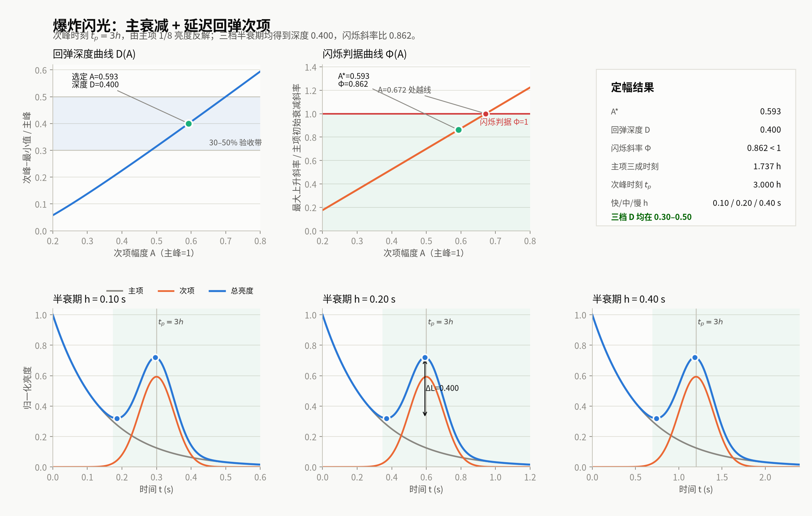

# flash

爆炸闪光的两项亮度模型：单调衰减的主闪光，加上一个延迟、成峰的回弹次项。

```text
L(t) = exp(-ln2 · t / h) + A · exp(-(t - tp)² / (2σ²))
tp = h · log₂(8) = 3h
σ  = h / 2
```

`h` 是主项半衰期，主峰归一化为 `1`。`make test` 跑自检；`make plot` 生成
`curves.csv`、`trace.csv` 和 `flash_tuning.png`（绘图需要 Python + matplotlib）。



## 1. 由半衰期反解次峰时刻

主项为：

```text
M(t) = exp(-kt) = 2^(-t/h),  k = ln2 / h
```

主项降到三成的时刻：

```text
2^(-t30/h) = 0.30
t30 = h · log₂(10/3) ≈ 1.73697h
```

因此“次峰落在主项三成以下”的区间条件是：

```text
tp > h · log₂(10/3)
```

这里取主项剩余 `1/8` 的位置反解次峰：

```text
tp = h · log₂(8) = 3h
M(tp) = 1/8 = 0.125 < 0.30
```

这不是另凑的延迟值：延迟随 `h` 等比缩放，半衰期改变后 `tp` 由同一个亮度门限重新得到。

## 2. 极小值存在条件

总亮度导数：

```text
L'(t) = -k exp(-kt)
       + A · (tp-t)/σ² · exp(-(t-tp)²/(2σ²))
```

当 `t ≥ tp` 时两项都为负，所以“先到极小值、再形成次峰”的两个驻点只能出现在
`tp` 之前。令 `y = tp-t`，驻点条件为：

```text
A · y/σ² · exp(-y²/(2σ²)) = k · exp(-k(tp-y))
```

定义不含 `A` 的左右比值 `R(t)`，则出现驻点对需要：

```text
A · max R(t) > 1
```

最大值位置满足：

```text
k + y/σ² - 1/y = 0
y* = (-kσ² + sqrt(k²σ⁴ + 4σ²)) / 2
```

代入 `tp=3h`、`σ=h/2`，得到临界幅度：

```text
Acrit ≈ 0.0982
```

等号对应退化切点；严格大于时才会有一个极小值和一个后续次峰。三成门限
`tp > t30` 是时间分离条件，`A > Acrit` 是实际产生驻点对的幅度条件，两者都满足才有清楚的一次回弹。

注意总亮度的实际次峰不在 `tp`，而在它稍前的 `t2 ≈ 2.9624h`：在 `tp` 处次项导数为零，但主项导数仍为负。

## 3. 用两条曲线定幅度

对每个 `A` 数值求 `L'=0` 的前两个根：

- `tmin`：负到正的导数交叉，即极小值；
- `t2`：正到负的导数交叉，即回弹次峰。

回弹深度曲线：

```text
D(A) = L(t2) - L(tmin)
```

闪烁判据用无量纲上升斜率：

```text
Φ(A) = max L'(t) / k,  t ∈ [tmin, t2]
```

`Φ > 1` 表示回弹的增亮边缘比主闪光初始衰减的速度尺度 `k` 更陡，容易被看成频闪故障而不是亮度回弹。

扫描结果：

| 次项幅度 `A` | 回弹深度 `D` | 闪烁判据 `Φ` | 含义 |
|---:|---:|---:|---|
| 0.4840 | 0.300 | 0.671 | 深度刚到下限 |
| **0.5929** | **0.400** | **0.862** | **选定：取验收带中心并保留闪烁余量** |
| 0.6720 | 0.474 | 1.000 | 闪烁曲线越线 |
| 0.7000 | 0.500 | 1.049 | 深度到上限，但已过闪烁判据 |

所以深度曲线给出的 `A ∈ [0.484, 0.700]` 被闪烁曲线收窄为
`A ∈ [0.484, 0.672]`。选定 `A=0.5929` 使 `D=0.400`，位于三成到五成带的中心，同时 `Φ=0.862<1`。

## 4. 三档半衰期结果

| `h` (s) | `t30` (s) | `tp=3h` (s) | `tmin` (s) | `L(tmin)` | `t2` (s) | `L(t2)` | `D` | `Φ` |
|---:|---:|---:|---:|---:|---:|---:|---:|---:|
| 0.10 | 0.1737 | 0.3000 | 0.18484 | 0.3195 | 0.29624 | 0.7195 | 0.4000 | 0.8617 |
| 0.20 | 0.3474 | 0.6000 | 0.36968 | 0.3195 | 0.59248 | 0.7195 | 0.4000 | 0.8617 |
| 0.40 | 0.6948 | 1.2000 | 0.73936 | 0.3195 | 1.18496 | 0.7195 | 0.4000 | 0.8617 |

模型全部时间按 `h` 缩放，因此三档的归一化深度和闪烁判据相同；自检也验证了快、慢两档的深度差小于 `1e-5`。

## CLI

```sh
make test
./flash --curves   # A,D,Φ 曲线 CSV
./flash --trace    # 三档 h 的亮度采样 CSV
```
